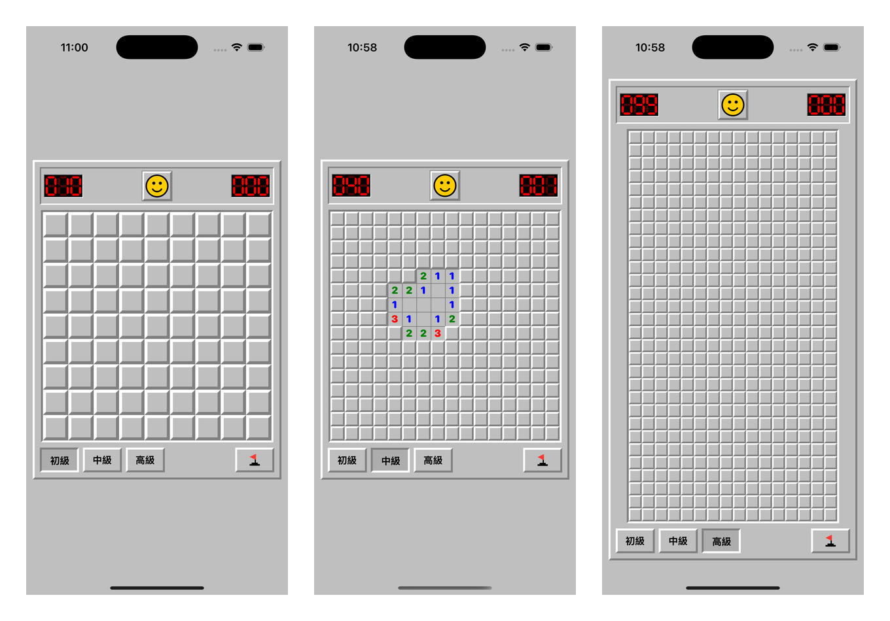

# 踩地雷

用 SwiftUI 做的 iOS 踩地雷，介面仿照舊版 Windows 的經典風格。遊戲規則主要用 if-else 判斷寫成。



## 功能

- 三種難度：初級 9×9（10 顆雷）、中級 16×16（40 顆雷）、高級 16×30（99 顆雷）
- 第一下一定不會踩到雷
- 點已翻開的數字，旗子數量正確時會自動翻開周圍格子
- 插旗模式：打開後點一下就是插旗
- 紅色七段顯示器：左邊是剩餘地雷數，右邊是計時
- 笑臉會跟著遊戲狀態改變表情，點一下重新開始
- 翻開、插旗、爆炸、獲勝的音效，全部在程式裡即時合成

## 操作

| 動作 | 效果 |
| --- | --- |
| 點一下 | 翻開格子 |
| 長按 | 插旗／取消插旗 |
| 點已翻開的數字 | 翻開周圍沒插旗的格子 |
| 點笑臉 | 重新開始 |

## 執行

需要 Xcode 16 以上，支援 iOS 17 以上的 iPhone。

```bash
open Minesweeper.xcodeproj
```

選一台 iPhone 模擬器後按 Run 即可。

專案檔是用 [XcodeGen](https://github.com/yonaskolb/XcodeGen) 從 `project.yml` 產生的，修改設定後可以重新產生：

```bash
xcodegen generate
```

## 檔案結構

```
Minesweeper/
├── Game.swift          遊戲邏輯：翻開、插旗、勝負判斷
├── ContentView.swift   主畫面與雷區
├── Components.swift    立體邊框、七段顯示器、地雷、旗子、笑臉
├── SoundPlayer.swift   合成音效
└── Assets.xcassets     App 圖示
tools/
└── make_icon.swift     產生 App 圖示的腳本
```
